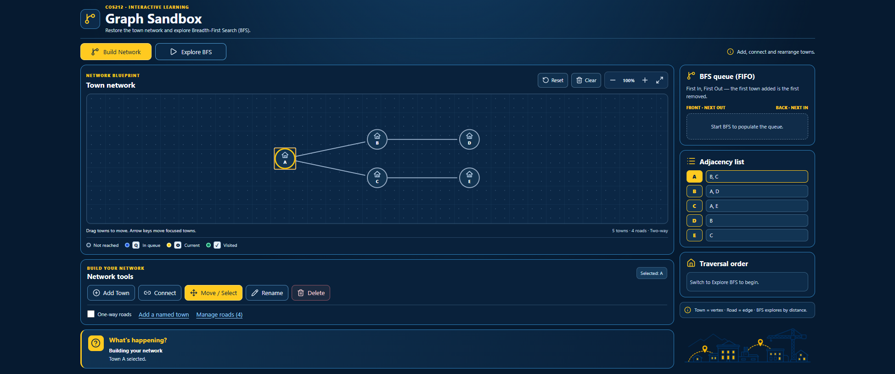
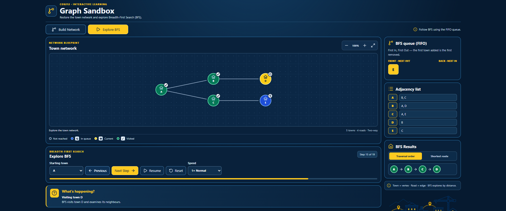

# Part 3 - Sandbox + Graph/Queue Visual (Kelita)

## Overview

Part 3 provides an interactive **Graph Sandbox** and reusable graph and queue visualisation components for the BFS learning application.

The Sandbox allows learners to build town networks, explore graph structures, visualise BFS, and find shortest routes. The shared components and algorithms can also be used by **Part 4** to support its learning activities.

### Features

**Graph Sandbox**
- Create, rename, and remove towns (vertices).
- Add and remove roads (edges).
- Switch between directed and undirected graphs.
- Explore neighbours and adjacency lists.
- Run BFS and follow the traversal step by step.
- Observe the queue and visitation order.
- Find and highlight shortest routes.

**Reusable Graph/Queue Visual**
- Display directed and undirected graphs.
- Handle vertex and edge selection.
- Display independently controlled queues and vertex states.
- Visualise BFS steps and highlight routes.
- Support read-only and interactive modes.

---

## Screenshots

### Build Network



Create and edit town networks by adding vertices and connecting them with roads.

### Explore BFS



Explore BFS step by step, observe the queue and visited vertices, and find shortest routes.

---

## Project Structure

```text
src/
├── assets/
│   └── town-skyline.png
├── part3/
│   ├── screenshots/
│   │   ├── build-network.png
│   │   └── explore-bfs.png
│   ├── GraphQueueView.css
│   ├── GraphQueueView.integration.test.tsx
│   ├── GraphQueueView.tsx
│   ├── GraphSandbox.css
│   ├── GraphSandbox.integration.test.tsx
│   ├── GraphSandbox.tsx
│   ├── graphUtils.test.ts
│   ├── graphUtils.ts
│   └── README.md
└── shared/
    └── types.ts
```

| File | Purpose |
|------|---------|
| `GraphSandbox.tsx` | Interactive Sandbox for graph editing and BFS exploration. |
| `GraphQueueView.tsx` | Reusable graph and queue visualisation component. |
| `graphUtils.ts` | Graph operations, adjacency lists, BFS, and shortest-route algorithms. |
| `*.css` | Styling for the Sandbox and visualisation component. |
| `*.test.ts(x)` | Unit and integration tests, including sandbox BFS, route, and graph-editing interactions. |
| `screenshots/` | Screenshots of the Sandbox's two modes. |
| `shared/types.ts` | Shared graph types used across the application. |

---

## Tech Stack & Dependencies

Part 3 is built using **React and TypeScript**, with Vite for development and Vitest for automated testing.

### Tech Stack

| Technology | Purpose |
|------------|---------|
| **React** | Builds the interactive Graph Sandbox and reusable Graph/Queue Visual component. |
| **TypeScript** | Provides type safety for graph models, component props, and algorithms. |
| **Vite** | Development server and build tooling. |
| **CSS** | Styling, layouts, animations, and responsive design. |
| **SVG** | Renders graph vertices, edges, and interactive connections. |

### Libraries & Testing Tools

| Dependency | Purpose |
|------------|---------|
| `lucide-react` | Icons used throughout the interface. |
| `vitest` | Runs automated unit and integration tests. |
| `@testing-library/react` | Tests React component rendering and interactions. |
| `jsdom` | Provides a simulated browser environment for integration tests. |

All dependencies are managed through the project's `package.json`.

### Installation & Running

From the project root (the directory containing `package.json`), install the dependencies:

```bash
npm install
```

Start the development server:

```bash
npm run dev
```

Open the local URL displayed in the terminal to access the application.

> **Windows PowerShell:** If PowerShell blocks npm scripts, use `npm.cmd` and `npx.cmd` instead.

---

## Using the Graph Sandbox

The Sandbox provides two modes:

### Build Network

Learners can create and modify a graph by adding towns and roads, renaming or removing vertices, and switching between directed and undirected graphs.

Each town represents a **vertex**, and each road represents an **edge**.

### Explore BFS

Learners can select a starting town, run BFS, move through traversal steps, observe the queue and visited vertices, and find the shortest route to a destination.

BFS uses a **FIFO (First In, First Out)** queue and processes neighbours alphabetically to produce a consistent traversal order.

---

## Reusing GraphQueueView

`GraphQueueView.tsx` is a reusable React component that displays a graph and its associated queue or traversal state.

Part 4 can control the graph, interactions, and visual states through component props without depending on the Sandbox's internal state.

### Basic Usage

The following example assumes the component is imported from a file directly inside `src/part4/`.

```tsx
import GraphQueueView from "../part3/GraphQueueView";
import type { GraphModel } from "../shared/types";

const graph: GraphModel = {
  directed: false,
  vertices: ["A", "B", "C"],
  edges: [
    { from: "A", to: "B" },
    { from: "B", to: "C" },
  ],
};

export default function Example() {
  return <GraphQueueView graph={graph} readOnly />;
}
```

### Component Props

| Prop | Description |
|------|-------------|
| `graph` | Graph model to display (**required**). |
| `steps` | BFS traversal steps. |
| `currentStep` | Current BFS step index. |
| `queue` | Queue controlled independently by the parent component. |
| `vertexStates` | Custom states for individual vertices. |
| `highlightedRoute` | Ordered route to highlight. |
| `highlightedEdges` | Additional edges to highlight. |
| `selectedVertex` | Currently selected vertex. |
| `onVertexClick` | Callback for vertex selection. |
| `onEdgeClick` | Callback for edge selection. |
| `onVertexMove` | Callback for vertex movement. |
| `onConnect` | Callback for connecting vertices. |
| `onCanvasClick` | Callback for canvas interactions. |
| `draggable` | Enables vertex dragging when editing is allowed. |
| `readOnly` | Prevents graph editing while allowing selection. |
| `showQueue` | Controls queue visibility. |
| `showLegend` | Controls legend visibility. |
| `title` | Optional heading. |
| `tool` | Active interaction tool. |
| `initialPositions` | Initial vertex positions. |
| `headerActions` | Custom header controls. |

All props except `graph` are optional.

### Common Usage Examples

**Independent Queue**

```tsx
<GraphQueueView
  graph={graph}
  queue={["A", "B", "C"]}
  readOnly
/>
```

The queue is displayed in FIFO order. The parent component controls updates to the queue.

**Custom Vertex States**

```tsx
<GraphQueueView
  graph={graph}
  vertexStates={{
    A: "visited",
    B: "active",
    C: "queued",
  }}
  readOnly
/>
```

Supported states: `unvisited`, `discovered`, `queued`, `active`, and `visited`.

**Vertex and Edge Selection**

```tsx
<GraphQueueView
  graph={graph}
  readOnly
  onVertexClick={(vertex) => console.log(vertex)}
  onEdgeClick={(from, to) => console.log(from, to)}
/>
```

Callbacks allow Part 4 to respond to selections without changing the graph.

**BFS Playback**

```tsx
import { runBfs } from "../part3/graphUtils";

const steps = runBfs(graph, "A");

<GraphQueueView
  graph={graph}
  steps={steps}
  currentStep={0}
  readOnly
/>
```

The parent component controls `currentStep` to display different stages of the traversal.

**Shortest-Route Highlighting**

```tsx
import { findShortestRoute } from "../part3/graphUtils";

const result = findShortestRoute(graph, "A", "C");

<GraphQueueView
  graph={graph}
  highlightedRoute={result.path}
  readOnly
/>
```

**Note:** `graph` is required even when only displaying a queue. An empty graph can be supplied if necessary.

---

## Graph Utilities

`graphUtils.ts` provides reusable graph operations and BFS algorithms independently of React.

| Function | Description |
|----------|-------------|
| `addVertex` | Add a vertex. |
| `removeVertex` | Remove a vertex and its connected edges. |
| `renameVertex` | Rename a vertex and update its edges. |
| `addEdge` | Add an edge. |
| `removeEdge` | Remove an edge. |
| `setDirected` | Switch between directed and undirected graphs. |
| `getNeighbours` | Retrieve neighbouring vertices. |
| `getAdjacencyList` | Generate an adjacency list. |
| `runBfs` | Generate BFS traversal steps. |
| `getVisitOrder` | Extract the BFS visitation order. |
| `getQueueAtStep` | Retrieve the queue at a specified step. |
| `findShortestRoute` | Find a shortest route using BFS. |

### Example

```tsx
import {
  getAdjacencyList,
  runBfs,
  getVisitOrder,
  findShortestRoute,
} from "../part3/graphUtils";

const adjacencyList = getAdjacencyList(graph);

const steps = runBfs(graph, "A");
const visitOrder = getVisitOrder(steps);

const route = findShortestRoute(graph, "A", "C");

console.log(adjacencyList);
console.log(visitOrder);
console.log(route.path);
console.log(route.roadCount);
```

Graph editing functions return updated graph models without modifying the original.

BFS respects directed edges, handles cycles and disconnected graphs, and uses alphabetical neighbour ordering.

Shortest routes minimise the **number of edges**, not physical distance or travel time.

---

## Integration with Part 4

Part 4 can import `GraphQueueView` for visualisation and `graphUtils.ts` for graph operations and BFS algorithms.

| Activity | Available Functionality |
|----------|-------------------------|
| A1 — Map the Town | Graph editing and vertex/edge selection. |
| A2 — Read the Registry | Neighbour lookup and adjacency lists. |
| A3 — Ticket Line | Independently controlled queue. |
| A4 — The Messenger | Vertex interaction and custom states. |
| A5 — Predict the Spread | BFS steps, visitation order, and playback. |
| A6 — Fewest Hops | Shortest-route calculation and highlighting. |

### Integration Notes

- Use the shared `GraphModel` type from `src/shared/types.ts`.
- Use `readOnly` when the graph should not be edited.
- Use `queue` and `vertexStates` to control the visualisation independently of BFS.
- Use `steps` and `currentStep` for BFS playback.
- Use `highlightedRoute` or `highlightedEdges` to highlight connections.
- Keep activity-specific state separate from the Sandbox.

---

## Testing

Part 3 includes automated unit and integration tests using Vitest and React Testing Library.

| Test File | Purpose |
|-----------|---------|
| `graphUtils.test.ts` | Tests graph operations, BFS, queues, and shortest-route algorithms. |
| `GraphQueueView.integration.test.tsx` | Tests component rendering, interactions, and reusable visualisation functionality. |

### Running Tests

Run all tests from the project root:

```bash
npx vitest run
```

Check for TypeScript errors:

```bash
npx tsc --noEmit
```

### Test Results

All **45 automated tests passed**, including 28 unit tests, 15 integration tests, and 2 shared-type tests. The TypeScript check also completed without errors.
